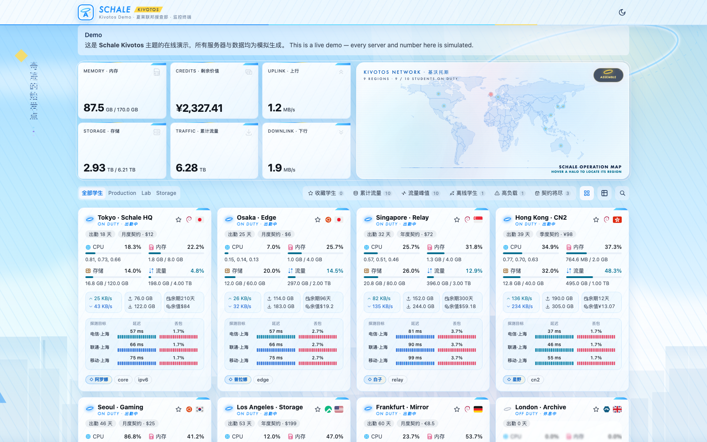
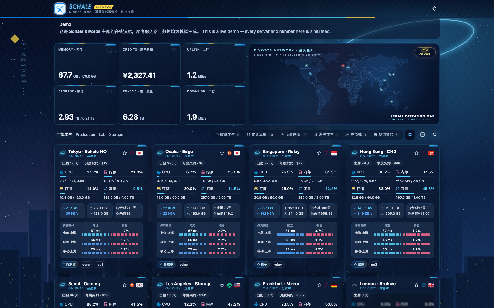
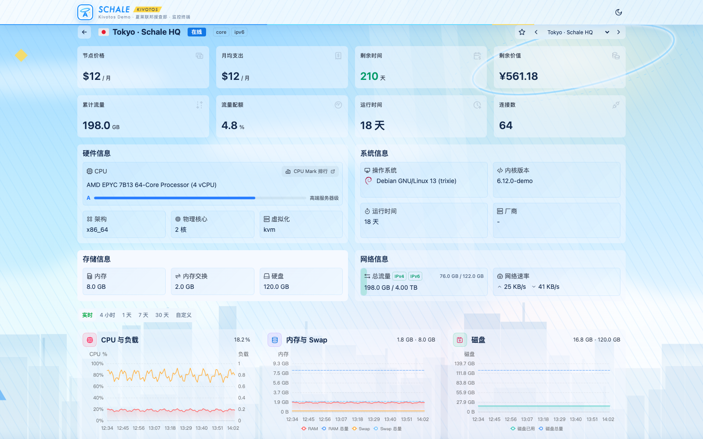
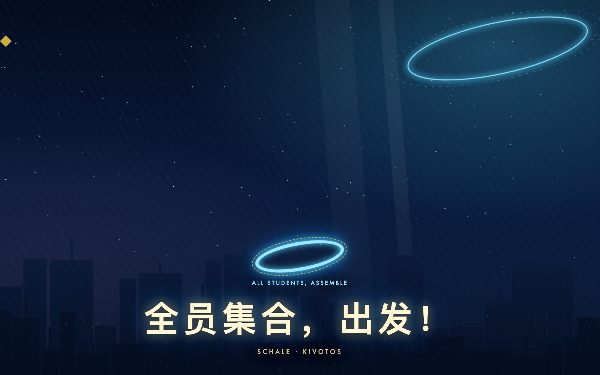

# Schale Kivotos · Komari Theme

A Blue Archive–inspired theme for [Komari Monitor](https://github.com/komari-monitor/komari): clear-sky and night-city modes, a Kivotos-style operation map, student name tags, and a customizable easter egg.

The demo runs entirely in your browser against a built-in mock backend with ten fictional servers. Every server, IP address, and number on that page is simulated.

| Light (clear sky) | Dark (night city) |
| --- | --- |
|  |  |

| Node detail | Easter egg |
| --- | --- |
|  |  |

## Features

- **Two modes.** Clear sky (light) and night city (dark), with an optional automatic switch based on Beijing time. Each viewer can toggle the mode from the header.
- **Blue Archive–style UI.** White glass panels, skewed blue corner tabs, diagonal stripe textures, halo indicators for online status, and the "SCHALE / KIVOTOS" header.
- **Kivotos network map.** A world map that marks the countries where your nodes are and highlights a region on hover.
- **Student tags.** Each node gets a unique student name as a decorative label. You can turn this off in the theme settings.
- **Customizable easter egg.** The image, title, subtitle, and button label are all theme settings. If you leave them empty, the theme uses its built-in original artwork.
- Everything from the upstream theme: card and list views, configurable overview cards, ping charts, load history, traffic and expiry warnings, a color-vision-friendly palette, and more.

## Installation

1. Download `komari-theme-Schale-Kivotos-*.zip` from [Releases](https://github.com/Kiramei/komari-theme-schale-kivotos/releases), or build it yourself (see below).
2. In the Komari admin panel, open **Theme management**, upload the zip, and activate **Schale Kivotos**.
3. Optionally adjust the settings under **Theme settings**.

## Using your own artwork

This repository contains no official Blue Archive artwork. The bundled backgrounds, halo logo, and easter-egg scene are original SVGs. To use your own images, put them on your Komari server under `data/theme/user-assets/` and reference them with `local:<file name>`:

| Setting | Purpose |
| --- | --- |
| `backgroundEnabled` + `lightBackgroundUrl` / `darkBackgroundUrl` | Page background for each mode |
| `gloriaHeroUrl` (`gloriaHeroType`: `image` / `video`) | Easter-egg backdrop |
| `easterButtonLabel`, `easterTitle`, `easterSubtitle` | Easter-egg text |

HTTPS URLs work as well. Please only use images you have the right to use.

## Development

Requires Node.js 20.19+ or 22.12+.

```bash
npm install
npm run dev          # dev server; proxies /api and /rpc2 to VITE_API_TARGET (default http://127.0.0.1:25774)
npm run build        # type-check + build dist/ and the theme zip
```

To build the GitHub Pages demo with its mock backend:

```bash
VITE_DEMO=1 VITE_BASE=/komari-theme-schale-kivotos/ npm run build:demo   # output: demo-dist/
```

The mock lives in [`src/demo/mock.ts`](src/demo/mock.ts). It is only bundled when `VITE_DEMO=1`, so it never ships in the theme zip.

## Credits

- This theme is a reskin of **[Gloria Universe](https://github.com/TonyStarkJr2021/komari-theme-Gloria-Universe)** by TonyStarkJr2021, which is MIT licensed. The architecture, data layer, charts, and most components come from that project. Many thanks to its author.
- **[Komari Monitor](https://github.com/komari-monitor/komari)**, the monitoring system this theme is built for.
- World map data: [Natural Earth](https://www.naturalearthdata.com/), public domain.

## Acknowledgements

Thanks to **Claude** (by Anthropic) for helping with the reskin, the demo mock backend, and this documentation.

## Disclaimer

This is an unofficial, non-commercial fan project. It is not affiliated with or endorsed by NEXON Games or Yostar. *Blue Archive* and related names are trademarks of their respective owners. Student names are used only as decorative text labels, and no official game assets are included in this repository.

## License

[MIT](LICENSE) © 2026 Kiramei. Portions © 2025 Tony Liu (upstream Gloria Universe / Glassmorphism theme).
